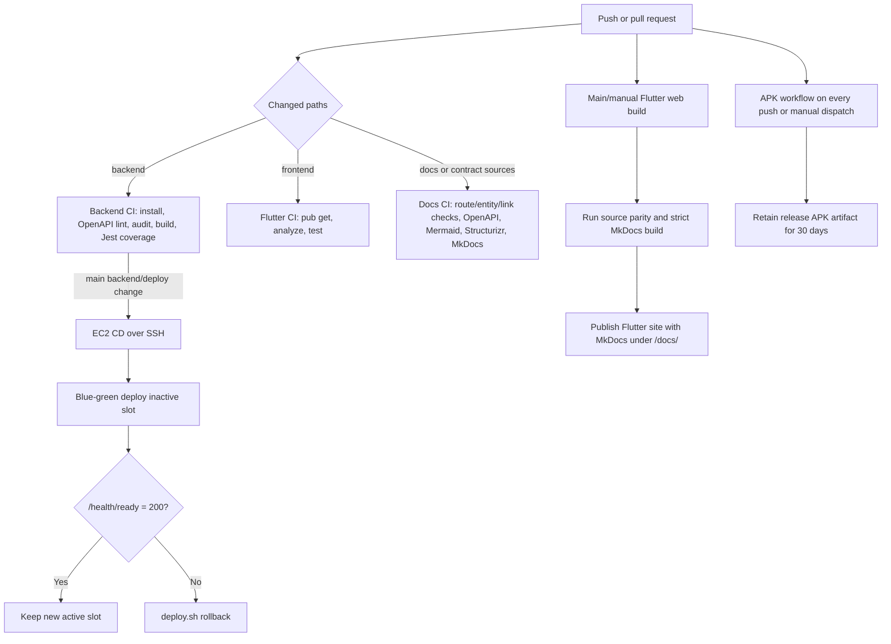

# CI/CD workflow

## Existing application gates

| Workflow | Trigger | Gates/output |
| --- | --- | --- |
| Backend CI | Backend push/PR | Reject tracked uploads, OpenAPI lint, production and full-tree dependency audits at high/critical severity, TypeScript build, Jest coverage |
| Backend CD | Main backend/deploy changes or manual | Repeats build/tests, SSH deploy, readiness check, automatic rollback attempt |
| Frontend CI | Frontend push/PR/manual | Flutter 3.44.8 dependency restore, analyze, tests |
| Build APK | Every push/manual | Firebase config + release signing from secrets, release APK with hosted API defines, artifact upload |
| Web/Docs Pages | Main/manual | Flutter web build plus validated MkDocs build, one combined Pages artifact (GitHub Pages `build_type: workflow`) |
| Documentation CI | Docs and source-of-truth changes | Contract parity, links, OpenAPI, Mermaid (Puppeteer no-sandbox config), Structurizr, strict MkDocs build |

## Required CI secrets

| Secret | Used by | Purpose |
| --- | --- | --- |
| `GOOGLE_SERVICES_JSON` | Build APK | Firebase Android `google-services.json` contents |
| `ANDROID_KEYSTORE_BASE64` | Build APK | Base64-encoded upload keystore (`.jks`) |
| `ANDROID_KEYSTORE_PASSWORD` | Build APK | Keystore password written to `key.properties` |
| `ANDROID_KEY_PASSWORD` | Build APK | Key password written to `key.properties` |
| `ANDROID_KEY_ALIAS` | Build APK | Key alias written to `key.properties` |
| `EC2_HOST` | Backend CD (production env) | SSH target host |
| `EC2_USER` | Backend CD (production env) | SSH username |
| `EC2_SSH_KEY` | Backend CD (production env) | SSH private key |

Backend CD skips the SSH deploy steps cleanly when any of `EC2_HOST`, `EC2_USER`, or `EC2_SSH_KEY` is unset, so missing production credentials do not fail the workflow.

Backend CI and CD build/test jobs use Node 24, matching the shared Docker image and the locked Firebase Admin dependency's Node >=22 requirement. The standalone `backend/compose.yaml` path is operated manually through the [Atlas Docker runbook](../operations/backend-docker-runbook.md); backend CD continues to target the EC2 blue-green stack.

## Backend dependency audit policy

Run `npm run audit:dependencies` from `backend/` to reproduce the Backend CI gate. It first runs `npm audit --omit=dev --audit-level=high` without exceptions. A successful production audit is followed by the pinned `audit-ci` full-tree audit with `backend/audit-ci.json`. Registry errors fail the gate. Moderate findings remain visible and do not block, matching the previous high/critical threshold.

The only temporary exception is [GHSA-vfj7-8cjw-p6xm](https://github.com/advisories/GHSA-vfj7-8cjw-p6xm), unpatched stack exhaustion in `braces` as of 2026-10-11. The configuration enumerates the reviewed development-tool paths through Jest, nodemon, and tsc-alias, including their hoisted transitive dependencies. It does not allowlist entire modules or other advisory IDs. Unknown paths, other high/critical advisories, and high/critical production findings still fail. Every exception expires at **2026-11-10 00:00 UTC**; after that instant the advisory blocks CI again. See [ADR-0013](../decisions/0013-time-limited-development-audit-exception.md).

`nodemon` is a development dependency and is absent from the production-only Docker dependency installation. Review upstream patches before the deadline, regenerate the lockfile with compatible fixes, and remove the exception once the full audit passes without it. Extending the exception requires a fresh risk review and an explicit configuration change; there is no automatic renewal.

## Release limitations

- Backend CD runs `git reset --hard origin/main` on the remote deployment checkout by design; it assumes `/opt/vitalink` is a dedicated deploy clone.
- The deploy preflight validates the JWT secret but readiness is responsible for the broader required-environment inventory.
- Migrations are not automatically executed by backend CD. Operators must follow the migration order in the deployment runbook.
- No source-backed approval gate, canary traffic policy, database backup gate, artifact signing/attestation, or post-deploy authenticated clinical smoke suite is present.

## Runtime property catalogue check

Frontend CI also runs `python3 ../scripts/properties/sync.py --check` after dependency installation. The workflow triggers for frontend code, the backend property-default JSON copy, and property scripts. This checks identical default catalogues, the generated Dart map, and static property-key references before Flutter analysis/tests.
